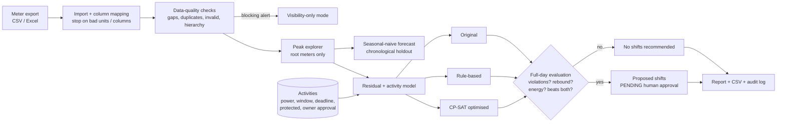

# PeakPehle — technical feasibility prototype

**AI Synergy Hackathon 2026 · Round 1 · Case 05 "The 4 PM Spike"**

A software-only, human-approved decision-support prototype that tests whether coordinated load shifting can reduce **full-day** maximum demand without disrupting critical operations. It follows our Basic SRS v1.0: import → validate → explore → model → compare (original vs rule-based vs CP-SAT optimised) → evaluate (full day, rebound, energy) → human approval → export.

> **All data in this repository is SYNTHETIC.** It demonstrates method behaviour only. It is not MITS Gwalior data and no result here is a campus saving. No rupee figures are shown because no tariff has been verified. There is no equipment-control code.

## Architecture



## Run

```bash
pip install -r requirements.txt
python data/make_synthetic.py      # synthetic readings, meter map, defective file
python run_demo.py                 # end-to-end CLI demo -> outputs/
python -m pytest -q                # 11 acceptance tests (SRS section 11)
streamlit run app.py               # prototype UI / wireframe
```

`notebooks/dataset_exploration.ipynb` is executed and shows data quality, hierarchy, daily profile and the forecast baseline.

## What the demo shows (synthetic)

**Set A — activities as observed:** after removing flexible loads, the residual (non-flexible) load itself peaks at 428 kW at 17:00. Rule-based and optimised schedules both reach 428 kW, so the optimiser does **not** beat both baselines and the system recommends **no shifts**. This is the SRS decision gate working: if flexible load can't beat a simple rule, don't claim success.

**Set B — stress test (larger flexible loads, pumps only allowed after noon):**

| Scenario | Full-day max | Peak time | 4–8 PM max | Energy | Verdict |
| --- | --- | --- | --- | --- | --- |
| Original | 672 kW | 17:30 | 672 kW | 6,435.5 kWh | baseline |
| Rule-based | 614 kW | 13:00 | 428 kW | same | **FAILED: rebound** (peak moved to 13:00) |
| CP-SAT optimised | **428 kW** | 17:00 | 428 kW | same | passes, beats both |

The naive rule stacks every load at the earliest allowed time and simply moves the peak to noon. The optimiser staggers them. That is why the SRS evaluates the full day, not only 4–8 PM. Energy is unchanged in every scenario: shifting is not saving energy, and the report never says otherwise.

Other behaviour checked by tests: malformed files and kWh/kW unit mismatch are rejected; duplicates, gaps and invalid values are flagged; parent + sub-meter double counting is blocked; protected and owner-unapproved activities never move; every shift stays inside its window and deadline; an impossible window returns **INFEASIBLE** instead of a fake schedule; the weekly seasonal-naive forecast (MAE 9.6 kW) beats daily-naive (28.8 kW) on a chronological holdout.

## Repository map

| Path | Contents |
| --- | --- |
| `peakpehle/data_io.py` | Import, column mapping, unit check, quality and hierarchy checks |
| `peakpehle/scheduler.py` | Rule-based and CP-SAT schedulers, full-day metrics, rebound judge |
| `peakpehle/forecast.py` | Seasonal-naive vs daily-naive forecast on a chronological holdout |
| `run_demo.py` | End-to-end demo; writes `outputs/report.md`, CSV, recommendations, audit log |
| `app.py` | Streamlit UI: upload, alerts, peak chart, scenario comparison, approve/reject, export |
| `data/` | Synthetic generator, readings, meter map, defective file, two activity sets |
| `notebooks/dataset_exploration.ipynb` | Executed dataset exploration |
| `docs/pseudocode.md` | Algorithm pseudocode |
| `tests/test_acceptance.py` | 11 tests incl. a hand-calculated scenario |

## Limitations (honest)
- Synthetic data and synthetic activities; real flexible loads, windows and ratings must be verified by an authorised operator.
- The residual load is estimated by subtracting assumed activity profiles from the root meter.
- Rebound rule (peak moves outside 4–8 PM and rises >10% there) is a stated design choice to be reviewed with facilities staff.
- Public datasets named in our brief (Building Data Genome Project 2, ASHRAE GEP III) are the next step for method testing; licences must be checked first.

## Declarations
Built with AI assistance (Claude) from the team's SRS and brief; design decisions owned by the team. Libraries: pandas, NumPy, Google OR-Tools, Streamlit, matplotlib, pytest.
